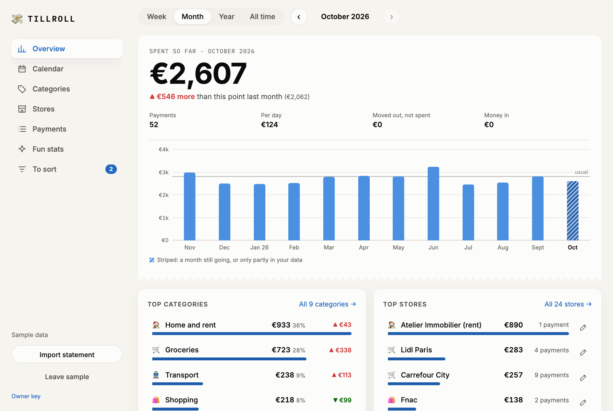
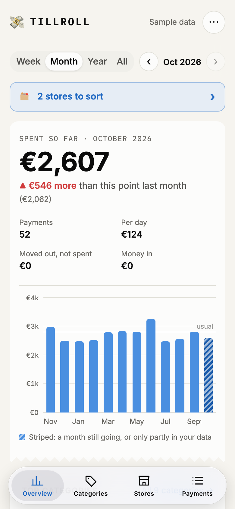
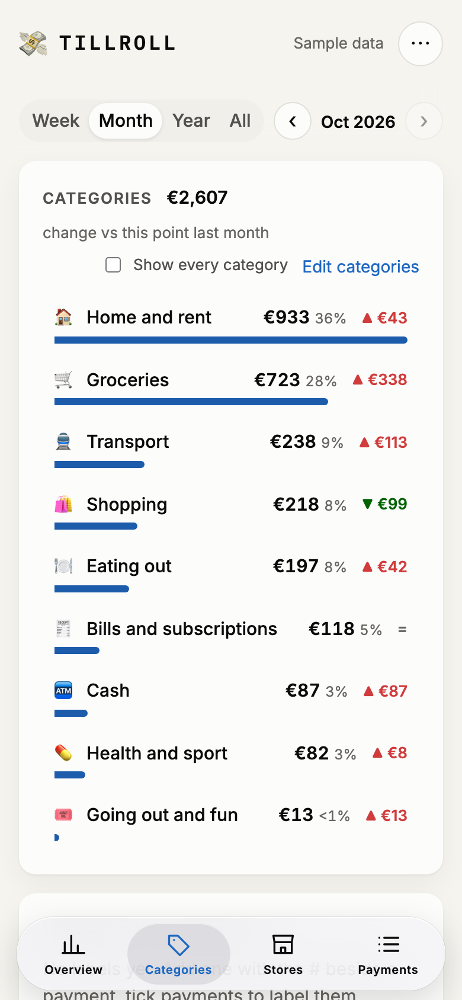
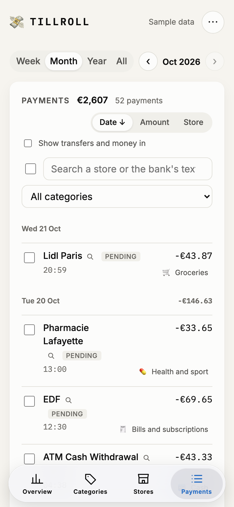
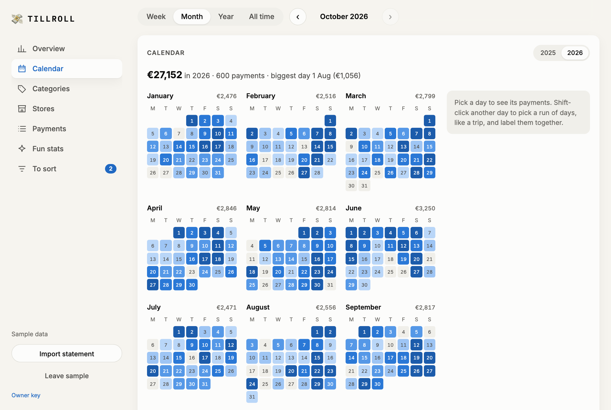

# 💸 Tillroll

Your Revolut spending by week, month, year or all time, by store and by category. Tillroll compares each period with
your usual one (or, for the current period, with the previous one at the same point) and points out what changed:
the categories that moved, your top store, new stores, the biggest payment, your big spending day and the payments
that come back every month.

<picture>
  <source media="(prefers-color-scheme: dark)" srcset="docs/screenshots/desktop-overview-dark.png">
  
</picture>

<p>
  <picture>
    <source media="(prefers-color-scheme: dark)" srcset="docs/screenshots/phone-overview-dark.png">
    
  </picture>
  <picture>
    <source media="(prefers-color-scheme: dark)" srcset="docs/screenshots/phone-categories-dark.png">
    
  </picture>
  <picture>
    <source media="(prefers-color-scheme: dark)" srcset="docs/screenshots/phone-payments-dark.png">
    
  </picture>
</p>

<picture>
  <source media="(prefers-color-scheme: dark)" srcset="docs/screenshots/desktop-calendar-dark.png">
  
</picture>

The screenshots show the sample data (Try it with sample data on the first screen), in your theme, light or dark.

Six views, under a period bar that stays at the top: in a sidebar on wide screens; on a phone, a tab bar holds
Overview, Categories, Stores and Payments, and the ⋯ menu opens the Calendar and Fun stats:

- **Overview**: the total and the chart, the top categories and stores, the latest payments (each with its category to
  change) and a few quiet notes on what stands out.
- **Calendar**: a whole year, one square per day, darker the more was spent, any year with data. A day lists its
  payments beside the months (at the bottom on a phone); a shift-click, or "Extend to another day", picks a run of
  days, like a trip, and its payments can get one label together, unticking the ones that do not belong. A month's
  name opens it in the overview.
- **Categories**: the total, each category with its trend over the chart's periods, and the **Labels**: each label with
  its total, payments and dates, to open, rename or delete everywhere. **Trends** shows a small bar chart per category
  instead (twelve months in the month view, each its own scale, two by two on a phone); one opens the category: its
  month by month, its average and where the money went over the last twelve months.
- **Stores**: with a search, a pencil on each store (name and category, the stores merged into it, look-alikes to merge
  in), and the **possible duplicates** deck.
- **Payments**: the total, by day like a bank statement or by amount or store, with a search and a category filter.
- **Fun stats**: an average day by weekday, spending by hour (when the payments have times), the biggest day, the
  weekend share, the longest runs with and without spending, the most loyal store, coffees, the typical payment,
  the payday effect.

A payment shows its time when the source gives one: statements do, while Revolut's Open Banking feed only gives the
day it was booked (sometimes the day after the payment). A small search link beside a store's name looks it up on
Google, for names that say nothing.

**Categorizing.** A payment's category is a button: it asks whether the choice is for its store (every payment there,
past and future) or for this payment only (an Amazon gift among household shopping, marked with a dot). Once two payments of a store
and amount have the same category of their own, the next ones of that amount take it too: two monthly transfers to one
account, a loan and its charges, sort themselves. Ticking
payments (shift-click for a run) gives one category or one label to all of them. **Stores to sort** goes through the
stores Tillroll is unsure about (no clue from the bank, only the broad shop merchant code, or a transfer to someone),
or every store still on a guessed category, biggest first: Keep accepts the guess, one tap on a category files the
store, and on a keyboard 1 to 9 pick a category and Enter keeps.

**Editing.** Edit categories renames a category, changes its icon or whether it counts as spending, and adds new ones.
Edit stores lists every store: rename it, pick its category, or tick the ones that are the same place to merge them
under one name (the store it was opened from keeps its name, and the merge keeps a category picked by hand). The
**possible duplicates** deck shows stores whose names share a rare word ("Ar Roue Morvan" and "Tavarn Ar Roue"), most
payments first: merge them, or mark them "not the same" and they never come back. A rename is a merge into the new
name, so both can be undone; renaming a store to another store's name asks first.

**Refunds** are money back from a store: the bank calls it a refund, or it is exactly what a card payment there cost.
Each one is matched with the payment it gives back (the latest one at that store in the 180 days before, the same
amount first), and that payment then costs what is left, in its own week and month: a flight refunded in April makes
March cheaper, not April. Payments shows "refund of 12 Mar" on the refund and "refunded" on the payment. A refund with
no payment found lowers the spending of the week it came in.

**Left out of every total**, spending and money in or out alike:

- **Between my accounts**: pockets, savings, top-ups, currency exchanges, and transfers that name the account holder
  (the synced accounts' names, "Valentin Dijkstra", also cut short by the bank as "DIJKSTRA VALENTI"). With two banks
  connected, the other side of such a move (the same amount the other way at the other bank, up to 3 days apart) goes
  there too, like a card payment to Revolut from the other bank. A payee put in Transfers by hand still goes there for
  those payments: Transfers is for money sent to other people.
- **Ignored**: tick payments in Payments and press Ignore (Count again undoes it), or pick Ignored as a category, for
  a store or one payment: a deposit, a purchase made for someone who paid it back.

**Labels** go on single payments: the # next to a booked payment adds one (with the labels already in use offered). A
pending payment gets a new id once the bank books it, so it has no #. The owner's choices are kept in the site store,
so they follow to every device; a visitor's stay in their browser.

## On the iPhone

In Safari, Share, then Add to Home Screen: Tillroll opens full screen like an app, with a tab bar for its four
sections (Overview, Categories, Stores, Payments). A home-screen app keeps its own cookies, apart from Safari's: the
owner enters their key once there, through the Owner key link at the bottom of the page.

## Several banks

The owner can connect more than one bank (Add a bank, in the sidebar or the ⋯ menu): Revolut and Crédit Coopératif
come first in the picker, any bank Enable Banking covers in the chosen country works. Each bank keeps its own session,
access end date and last sync; Sync and the daily run sync them all, and one bank failing does not stop the others.
In Enable Banking's free mode, link the bank's accounts in the Control Panel (Activate by linking accounts) before
connecting it here.

Statements fill the history before a bank's sync starts (where they overlap, the synced rows win, bank by bank).
Import Revolut's (Excel or CSV), Crédit Coopératif's CSV export, or PayPal's activity download (paypal.com, Activity,
Statements, Activity download, as CSV; in English or French). Crédit Coopératif's export uses the bank's own
category as a clue, and words each line like the sync does ("PRLV BPCE Vie", "VIR SEPA AKENEO"), so stores sorted
on synced rows stay sorted in the older months. Its deferred debit card does not list card payments one by one: each
month's debit becomes one payment, "Carte ...7497 (débit différé)", on the last day of the month it pays for. Import
the card's own CSV export too (same columns, one line per card payment) and those monthly debits make way for the
payments they paid, each on the day it was made: a monthly debit leaves when the card lines debited that month add up
to it, to the cent. Card texts make one store whether they come from the sync ("CB CAFE POP FACT 270826") or a
statement ("CAFE POP"). Synced
card payments keep the day they were made ("FACT 270826"), not the day the card is debited.

**PayPal** connects like a bank (or comes in through its activity download) and names the shop of each payment, where
the bank only says "PayPal". A bank payment to PayPal of the same amount, up to 4 days apart, is the money that paid
it: it goes to Between my accounts, so the purchase counts once, at its shop. In another currency the shop's name
matches them instead. Money between PayPal and the bank, and currency conversions, are between one's accounts too.
Payments and the latest payments show each payment's bank as a coloured initial: R, C, P.

## Run your own

You need an Enable Banking account (free), a Vercel account (free) and about 15 minutes.

1. **Fork this repository** and import it in Vercel. In the project's Storage tab, add an Upstash Redis store: Vercel
   adds `KV_REST_API_URL` and `KV_REST_API_TOKEN`. The functions run in Frankfurt (`regions` in `vercel.json`), next
   to a store in eu-central-1: every page load reads all the payments, so keep them in the same region.
2. **Register an Enable Banking application** in the [Control Panel](https://enablebanking.com/cp/applications):
   - environment: Production;
   - let the page generate the key: it downloads `<application id>.pem`, keep it safe;
   - redirect URL: `https://<your site>/api/callback` (Enable Banking refuses `http://` and local addresses);
   - the privacy and terms links and the email are not checked in restricted mode.
3. **Activate it by linking your accounts**: "Activate by linking accounts" in the Control Panel, log in to Revolut and
   link every account you want to see. The application can then read those accounts, and only those.
4. **Set the variables** in Vercel (see `.env.example`):
   - `OWNER_KEY` and `CRON_SECRET`: two long random strings (`openssl rand -hex 32`);
   - `ENABLE_BANKING_APP_ID`: the application id;
   - `ENABLE_BANKING_PRIVATE_KEY`: the content of the `.pem` file;
   - `BANK_COUNTRY`: the country Enable Banking lists your Revolut under, like `FR` (default) or `SE`. Another bank
     works too: set `BANK_NAME` to its name as Enable Banking lists it;
   - `ENABLE_BANKING_REDIRECT_URL`: `https://<your site>/api/callback`. Production would find it alone, but with it
     set, a local copy pulled with `vercel env pull` sends the bank back to the site too.
5. **Connect**: redeploy, open `https://<your site>/#owner=<OWNER_KEY>` once and click Connect Revolut. Revolut asks
   you to approve in its app, then sends you back.

Owner mode is a cookie: the page sends the key to `POST /api/login` once, and the server answers with an HttpOnly,
Secure cookie that lasts a year (derived from `OWNER_KEY`, so changing the key signs every browser out). Cookies set
by the server keep their lifetime in Safari, unlike the page's own storage, which Safari clears after 7 days without a
visit. Each browser needs the key once: the `#owner=` address, or the Owner key link at the bottom of the page. Leave
owner view, at the bottom too, ends it.

The first sync runs right after you connect and fetches as far back as Revolut allows: many banks give the full
history only in that first hour. Then a sync runs every day at 05:00 UTC (Vercel Cron, `vercel.json`) and each time
you open the page, when the last one is more than 6 hours old. For older history, import statements: where they
overlap the bank's history, the bank's rows win.

The access lasts as long as the bank allows (often 180 days). After that the page offers to reconnect. Banks allow a
few background syncs a day (often 4); syncs you start from the page do not count against that.

## How it works

- `api/`: Vercel functions. `login` and `logout` start and end owner mode, `connect` starts the bank authorization, `callback` takes the bank's answer and runs the
  first sync, `sync` runs a sync (the daily cron or the owner's page), `data` returns the owner's transactions, `rules`
  saves a category picked for a store, `categories` saves the categories changed or added, `merges` merges or
  separates stores, `labels` saves the labels of payments, `payment-categories` the categories picked for single
  payments, `distinct` the pairs of stores marked not the same, `import` saves the owner's statement rows, `disconnect` ends the access.
  `_lib/bank.ts` talks to Enable Banking: requests are signed with the application's key (an RS256 token made with
  `node:crypto`, no library).
- Redis keys, all `tillroll:*`: the bank session, the booked transactions by id, the pending ones from the last sync,
  the category picked per store and per payment, the categories changed or added, the stores merged, the labels, the
  pairs of stores marked not the same and the time of the last sync.
- `src/`: the React page. `statement.ts` reads the Revolut files, `stores.ts` and `categories.ts` name and sort the
  payments, `report.ts` builds the totals, the chart series and the insights, `sample.ts` makes the sample data.
- Visitors' data never reaches the server: no route accepts it without the owner's cookie (or the key).

## Develop

```sh
npm install
npm run dev   # http://127.0.0.1:5192, serves api/ too (local-api.ts)
```

The visitor side needs nothing else. For the owner side, pull the variables with
`vercel env pull .env.local --environment=production` and open `http://127.0.0.1:5192/#owner=<OWNER_KEY>`. Local and
production share the Redis store, so they show the same data. Enable Banking only sends the bank's answer to an https
address: Connect Revolut from local goes through the production callback and lands on the site.
Before a commit: `npm run format`, `npm run lint` and `npm run build`.
